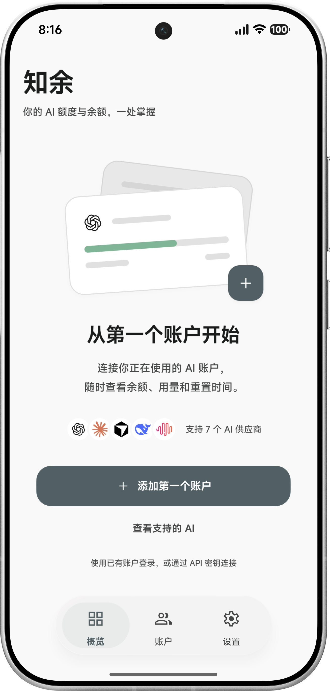
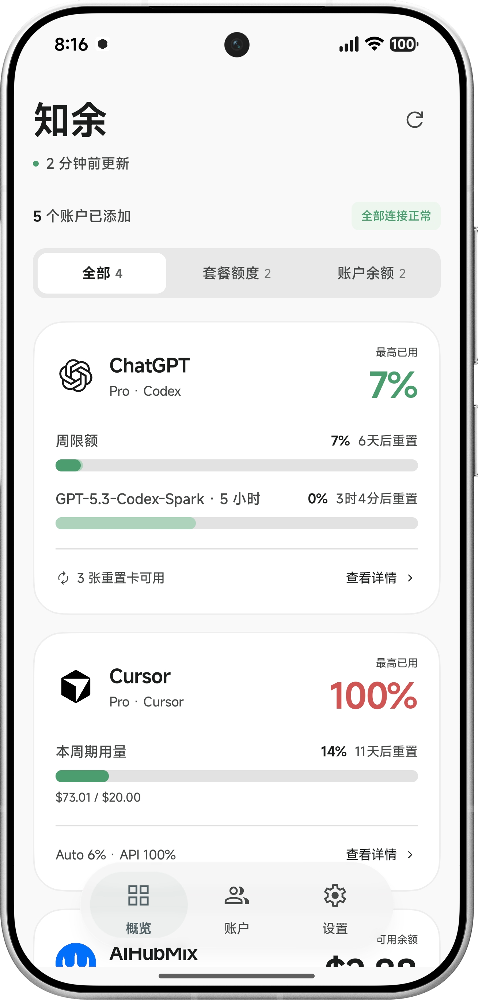
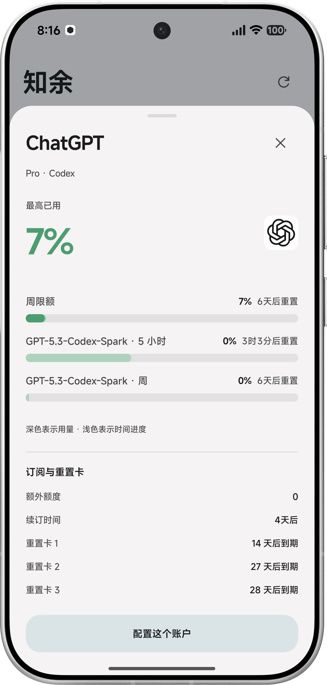
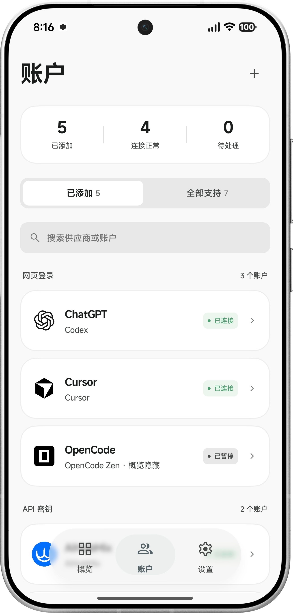
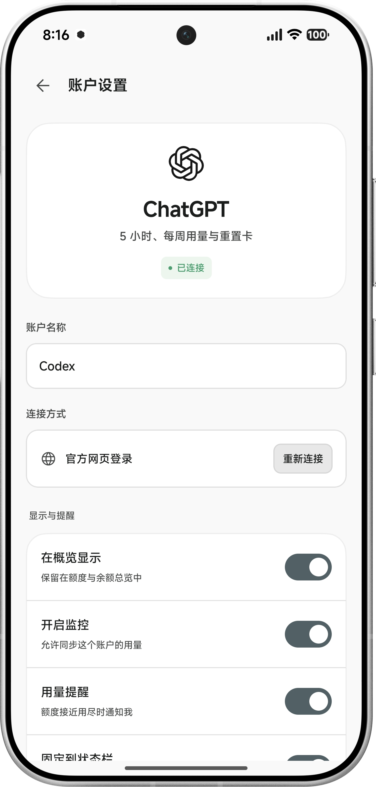

<div align="center">
  
  <h1>知余</h1>
</div>

<div align="center">

简体中文 | [English](README_en-US.md)

支持多平台 AI 用量和账户余额监控的 Android 应用，在应用、桌面小组件和常驻通知中随时查看你的 AI 额度

[](https://developer.android.com) [](https://kotlinlang.org) [](https://developer.android.com/jetpack/compose) [](LICENSE) [](https://github.com/Vectorking-50kg/Zhiyu/releases/latest)

</div>

<div align="center">
  
  
  
  
  
</div>


## 声明

知余是独立的第三方项目，与所支持的平台不存在任何官方的隶属或背书关系。

## 获取应用

从 GitHub Releases 页面获取最新 APK：[Releases](https://github.com/Vectorking-50kg/Zhiyu/releases)

- **系统要求：** Android 8.0（API 26）及以上。

## 主要功能

- **多平台、多账号概览**：统一查看套餐额度和账户余额，按类型筛选；用深浅两层进度条对照用量与周期时间。
- **独立账户管理**：添加、搜索和重命名账户，分别控制概览显示、后台监控、提醒与状态栏固定；暂停监控后保留缓存。
- **通知与桌面小组件**：无需打开 App 即可查看用量；额度达到 80% / 95%、检测到额度重置或网页登录失效时提供提醒。
- **后台刷新与失败处理**：可选 15 / 30 / 60 分钟刷新间隔；区分网络失败、限流和登录失效，失败时保留上次有效数据及更新时间。
- **两种界面风格**：切换 Material / Miuix，支持浅色、深色、跟随系统、纯黑背景、系统动态配色和自选颜色。
- **本地凭据与备份**：加密保存应用使用的登录凭据和 API 密钥，通过 JSON 文件导出、导入账户连接与配置。

## 支持的平台

| 平台 | 接入方式 | 当前可读取的信息 |
| --- | --- | --- |
| **ChatGPT** | 网页登录；可选设备码授权 | Codex 相关的 5 小时与周限额、附加窗口、Code Review、重置卡、续订信息、额外额度 |
| **Claude** | 网页登录；可选 OAuth 授权 | 5 小时与周限额、模型分类窗口、Claude Design、额外用量百分比 |
| **Cursor** | 网页登录 | 本周期用量、Auto 用量、API 用量与套餐信息 |
| **Antigravity（Google AI）** | 应用内 Google 授权；可手动改用浏览器 | Gemini、Claude and GPT 两组的 5 小时与周额度、各模型额度、重置时间及订阅名称 |
| **Devin** | 内置浏览器登录（Google 或邮箱） | 日额度、周额度、重置时间与额外用量余额 |
| **GitHub Copilot** | GitHub 设备码授权 | AI 积分或高级请求额度及重置时间、聊天和补全额度，以及接口提供的额外用量金额和预算 |
| **OpenCode Zen** | 网页登录 | 账户余额 |
| **OpenCode Go** | OpenCode 控制台的 API Key | 5 小时、周与月订阅额度及重置时间 |
| **MiniMax** | Token Plan 对应的 API Key | 5 小时与周限额、无限制标识、额度提升（Boost） |
| **AIHubMix** | API Key（令牌） | 账户余额、累计消费、累计请求次数 |
| **DeepSeek** | API Key | 可用余额、赠送余额、充值余额 |

实际展示取决于账户权限、订阅类型及平台返回的字段。表中列出的是已实现的解析能力，不代表所有账户都会返回全部指标；

部分平台接入依赖网页登录后的内部接口或控制台页面，平台调整接口后可能需要更新应用。

## 开始使用

1. 打开应用，点击「添加第一个账户」；也可以在「账户」页添加更多账户。
2. 选择平台并按照页面提示连接。Antigravity、Devin 和 GitHub Copilot 均可在手机上发起登录，操作步骤见下方。
3. 登录或密钥通过校验后，返回「概览」查看额度与余额，点击「查看详情」查看各个窗口与重置时间。
4. 在「账户」中按需开启监控、提醒和状态栏固定；在「设置」中调整外观、刷新间隔和全局通知。
5. 如需桌面展示，通过系统的小组件选择器添加知余小组件。

OpenCode Go 与 Zen 在账户页归入同一个 OpenCode 分组。Go 使用控制台中已开通订阅的账户的 API Key，通过官方 `GET https://opencode.ai/zen/go/v1/usage` 查询订阅额度；Zen 单独展示账户余额。密钥获取与订阅说明见 [OpenCode Go 官方文档](https://opencode.ai/docs/go/)，响应字段以 [官方接口源码](https://github.com/anomalyco/opencode/blob/dev/packages/console/app/src/routes/zen/go/v1/usage.ts) 为准。

### 连接 Antigravity（Google AI）

选择 Antigravity 后，在知余的内置网页中登录用于 Antigravity 的 Google 账号并授权。知余会自动截获授权回调，验证账号和额度后加密保存，无需切换到外部浏览器再返回。若 Google 阻止内嵌登录，可手动选择「改用浏览器」；备用流程在同一部手机完成，回调 5 分钟内有效。连接后可自动续期和后台刷新，无需从电脑复制令牌。

付费订阅优先显示接口明确提供的 Gemini、Claude and GPT 两组的 5 小时与周额度；免费账户或不支持汇总接口的账户显示各模型额度，不推测窗口时长。订阅名称按 Google 实际返回的名称显示。这些是 Antigravity 的额度，不代表 Gemini App、AI Studio 或 Google One 的全部权益。接口参考 [TokenTracker](https://github.com/xiufengsun/TokenTracker/blob/a3f10f2289c24f6612f26b8becbba4ff797c7754/src/lib/usage-limits.js)，实现细节与验证范围见 [Antigravity 接入说明](ANTIGRAVITY.md)。

### 连接 Devin 与 GitHub Copilot

- **Devin**　在知余打开 Devin 登录页，选择 Google 或邮箱登录。登录后若弹出提醒，请在要监控的组织里打开任意已有对话。还没有对话时，请新建一个并发送一条消息。知余会自动尝试读取额度。 [Devin 用量说明](https://docs.devin.ai/admin/billing/usage) · [CodexBar 接口参考](https://github.com/steipete/CodexBar/blob/main/docs/devin.md)
- **GitHub Copilot**　在知余复制设备码，打开同一部手机的浏览器，在 GitHub 页面输入设备码并授权知余。返回知余后，应用会确认授权并读取 Copilot 额度。组织席位如果只返回已用积分，界面会显示该数值。 [GitHub 设备流文档](https://docs.github.com/en/apps/oauth-apps/building-oauth-apps/authorizing-oauth-apps#device-flow) · [GitHub 积分说明](https://docs.github.com/en/copilot/how-tos/manage-and-track-spending/monitor-ai-usage) · [Copilot 额度接口参考](https://github.com/steipete/CodexBar/blob/main/docs/copilot.md)

连接成功后可开启后台监控。Devin 或 GitHub 会话失效时，可以在「账户设置」重新连接。已有令牌也可通过「手动输入令牌」添加。额度查询使用平台的内部接口，实际返回受订阅和授权权限影响。

## 桌面小组件

在「设置 → 桌面小组件」预览并添加，也可以长按桌面空白处，从系统小组件列表选择知余。

| 布局 | 建议尺寸 | 用途 |
| --- | --- | --- |
| 订阅总览 | 4×4 | 多账户额度与余额列表，可滚动、刷新；支持全部账户、跟随状态栏固定或自选账户 |
| 订阅详情 | 4×2 | 一个账户的额度窗口、重置时间或余额明细 |
| 订阅卡片 | 2×2 | 一个账户的主指标、缓存状态与重置时间 |
| 紧凑监控栏 | 4×1 | 一行显示 2–3 个常用账户，更多账户可点击「+」查看 |

每个组件独立选择账户，点击数值打开对应账户详情，长按桌面上的组件可重新配置。总览、详情和卡片提供后台刷新按钮。组件读取与应用相同的账户缓存，后台刷新完成后同步更新；网络失败、暂停监控或凭据失效时保留最后成功数据并标记状态。颜色跟随系统深浅色，实际占格取决于桌面网格。

布局与配置流程参考了 [Breezy Weather 的多尺寸组件](https://github.com/breezy-weather/breezy-weather/tree/main/app/src/main/kotlin/org/breezyweather/remoteviews) 和 [Glance Widget Demo](https://github.com/Seo-4d696b75/glance-widget-demo)，实现采用 [AndroidX Glance](https://developer.android.com/develop/ui/compose/glance)。

## 数据与隐私

- **网络请求**：登录、授权和额度查询会向对应平台及其认证服务发送必要信息。应用不会将账号凭据或用量数据上传到服务器。
- **本地存储**：应用凭据存储使用 AndroidX Security Crypto 加密；偏好、用量缓存与 WebView 网站数据分别由对应的本地存储机制管理。
- **备份文件**：导出的备份文件是包含登录凭据与密钥的**未加密 JSON 文件**。请妥善保存，仅从可信来源导入，不要附在 Issue、截图或公开仓库中。
- **反馈问题**：提供系统版本、App 版本、平台名称和复现步骤即可；请移除 Cookie、Token、API Key、完整授权链接及可识别账户的信息。

## 本地构建

建议使用 Android Studio，配置 JDK 17 和 Android SDK Platform 35。仓库包含 Gradle Wrapper，无需另行安装 Gradle。

默认构建使用知余的 GitHub OAuth 应用。维护派生版本时，可注册自己的 OAuth App、启用设备流，然后通过 Gradle 的 `zhiyu.githubCopilotClientId` 属性设置公开 Client ID。 [GitHub OAuth 应用注册](https://docs.github.com/en/apps/oauth-apps/building-oauth-apps/creating-an-oauth-app)

Antigravity 的 OAuth 注册配置在构建时注入，仓库不保存实际值。本地可在已忽略的 `local.properties` 中配置 `zhiyu.antigravityClientId` 和 `zhiyu.antigravityClientSecret`，也可使用同名 Gradle 属性，或环境变量 `ANTIGRAVITY_OAUTH_CLIENT_ID` / `ANTIGRAVITY_OAUTH_CLIENT_SECRET`。注册参数来源见 [Antigravity 接入说明](ANTIGRAVITY.md)。未配置时其他平台仍可使用，Antigravity 登录页会提示配置缺失。

```bash
git clone https://github.com/Vectorking-50kg/Zhiyu.git
cd Zhiyu

# 构建调试安装包
./gradlew :app:assembleDebug

# 构建正式安装包（发布前需配置 Release 签名）
./gradlew :app:assembleRelease

# 安装到已连接并开启 USB 调试的设备
./gradlew :app:installDebug
```

Debug 和 Release 使用不同包名，可以同时安装，账号与设置各自独立。以当前版本为例：

| 构建类型 | 应用名称 | 包名 | 版本名称 |
| --- | --- | --- | --- |
| Release | 知余 | `funapp.ctrlcv.zhiyu` | `0.1.6` |
| Debug | 知余 Debug | `funapp.ctrlcv.zhiyu.debug` | `0.1.6-debug` |

基础版本统一在 `app/build.gradle.kts` 的 `defaultConfig` 中维护；Debug 自动追加 `-debug`，Release 不追加后缀。应用内“关于”页也会显示对应版本名称。

开发验证可运行：

```bash
./gradlew testDebugUnitTest :app:lintDebug
```

连接模拟器或测试设备后，可验证开启 Release 混淆的通知状态读写：

```bash
./gradlew -I gradle/release-check.init.gradle :app:connectedReleaseCheckAndroidTest
```

该验证构建使用独立的 `.releasecheck` 包名和 Debug 签名；通知状态与编解码实现仍参与混淆。

## 自动发布

把 `app/build.gradle.kts` 中提高后的 `versionName` 和 `versionCode` 推到 `main`，**Android Release** 工作流会依次发布上一个正式版之后尚未发布的版本。每个版本都从版本号生效的提交构建，测试和覆盖安装通过后发布 `vX.Y.Z`，附带 `Zhiyu-X.Y.Z.apk` 和从提交标题生成的更新日志。

在仓库的 **Settings → Secrets and variables → Actions** 配置以下构建与签名 Secrets。签名使用之前给正式版 APK 签名的同一份 `.jks` 或 `.keystore`。[GitHub Actions Secrets 文档](https://docs.github.com/en/actions/how-tos/write-workflows/choose-what-workflows-do/use-secrets#storing-base64-binary-blobs-as-secrets)

| Secret | 填写内容 |
| --- | --- |
| `ANTIGRAVITY_OAUTH_CLIENT_ID` | Antigravity installed-app OAuth 注册的 Client ID |
| `ANTIGRAVITY_OAUTH_CLIENT_SECRET` | 与上述注册匹配的 OAuth client secret；用于构建注入 |
| `ANDROID_RELEASE_KEYSTORE_BASE64` | 签名文件的 Base64 文本 |
| `ANDROID_RELEASE_STORE_PASSWORD` | 签名文件密码 |
| `ANDROID_RELEASE_KEY_ALIAS` | 密钥别名 |
| `ANDROID_RELEASE_KEY_PASSWORD` | 密钥密码 |

在 macOS 上可将签名文件转换为 Base64 并直接复制到剪贴板。将路径替换为你的文件。

```bash
base64 -i '/完整路径/zhiyu-release.jks' | pbcopy
```

补发时，在 **Actions → Android Release → Run workflow** 选择 `main`，填写 `from_version` 和 `to_version`。例如用 `0.1.2` 到 `0.1.5` 补齐这四版，两个输入填写相同的值可单独补发一版。已发布的版本会跳过，旧版补发后仍可从 Releases 列表下载。失败的运行可通过 **Re-run jobs** 重试。

## 项目结构

```text
app/                  应用入口、导航、概览 / 账户 / 设置 / 外观页面
core/
  domain/             领域模型与数据仓库接口
  network/            平台接口、解析、OAuth 与网络错误处理
  storage/            凭据、账户配置、外观偏好与备份
  data/               数据仓库、缓存、后台刷新与通知
  ui/                 当前主题、图标和通用 Compose 组件
feature/
  auth/               WebView 登录与授权界面
  widget/             桌面小组件
```

## 反馈与贡献

欢迎通过 [Issues](https://github.com/Vectorking-50kg/Zhiyu/issues) 反馈问题或提出需求。

## 许可与致谢

本项目采用 **[MIT License](LICENSE)**，允许使用、修改、商业使用和再分发，并需保留版权及许可声明。

第三方代码与资源继续适用各自的原始许可证，详见 [许可说明](LICENSING.md) 和 [随包许可文本](app/src/main/assets/licenses)。

感谢 [Miuix](https://github.com/miuix-kotlin-multiplatform/miuix)、[MaterialKolor](https://github.com/jordond/MaterialKolor)、[Lobe Icons](https://github.com/lobehub/lobe-icons)、[Material Symbols](https://github.com/google/material-design-icons)、[CodexMeter](https://github.com/KyoMio/CodexMeter) 项目。
